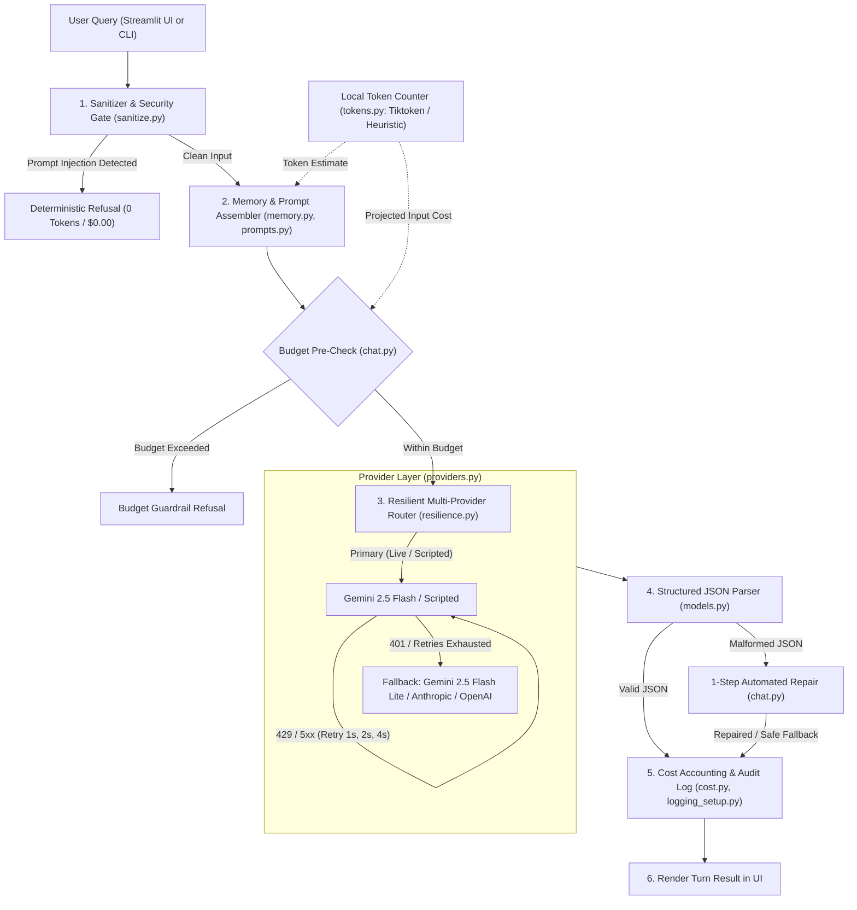

# Multi-Provider LLM Chatbot

[](https://github.com/adwitiya-pandey/multi-provider-llm-chatbot/actions/workflows/ci.yml)
[](https://www.python.org/downloads/)
[](https://opensource.org/licenses/MIT)
[](https://github.com/astral-sh/ruff)

A modular, production-tested multi-provider LLM chatbot in Python built directly on the official **Google GenAI (`google-genai`)**, **Anthropic (`anthropic`)**, and **OpenAI (`openai`)** SDKs. It features strict Pydantic input/output validation, exponential backoff retries, automatic provider/model fallback, sliding-window conversation memory with tiktoken token counting, self-healing structured JSON output parsing, real-time token/USD cost tracking against a hard spending ceiling, and an interactive Streamlit UI.

---

## Architecture Overview



---

## Key Features

1. **Native Multi-Provider SDK Adapters**: Clean separation of concerns with direct SDK adapters for Google GenAI, Anthropic, and OpenAI, plus an offline Scripted demo adapter. Banned from using third-party orchestration wrappers (LangChain, LiteLLM) via AST inspection.
2. **Exponential Backoff & Automatic Fallback**: Intelligently handles transient failures (HTTP 429, 500, 502, 503, 504, timeouts) with doubling delays (`1.0s`, `2.0s`, `4.0s`), while immediately switching to fallback providers on authentication errors (`HTTP 401`).
3. **Structured JSON Output & 1-Step Self-Healing Repair**: Every LLM turn enforces strict adherence to `StructuredReply`. If a model returns invalid JSON, an automated 1-step repair loop corrects the schema error before falling back to a deterministic safe reply.
4. **Deterministic Prompt Injection Defense**: Pre-execution regex inspection catches adversarial jailbreaks ("ignore previous instructions", "reveal system prompt", "DAN mode") and short-circuits with a deterministic refusal at **0 token cost**.
5. **Sliding-Window Memory**: Bounded conversation buffer evicting oldest turns first when turn count (>10) or estimated token budget (>6,000) limits are reached.
6. **Real-Time Token & Cost Accounting**: Tracks cumulative input/output tokens and notional USD cost per provider, enforcing a configurable hard spending ceiling (`$0.50` default).
7. **Streamlit UI & Scriptable CLI**: Interactive web interface featuring live telemetry, budget consumption gauges, context token gauges, expandable inspection trays, and a 3-turn automated CLI runner.
8. **Tiktoken BPE Token Counting & Pre-Flight Financial Guards**: Local sub-word token estimation powered by OpenAI's `tiktoken` library (`o200k_base` / `cl100k_base`) with lazy process-level caching. Enforces hard pre-flight budget ceilings before dispatching API calls, counts chat format framing overhead per OpenAI Cookbook, and powers sliding-window memory eviction with a graceful heuristic fallback.

---

## Provider Fallback Matrix

| Role | Default Model | Provider | Failure Trigger | Fallback Action |
| :--- | :--- | :--- | :--- | :--- |
| **Primary (Live)** | `gemini-2.5-flash` | Google GenAI | 429 / 5xx | Retry up to 3 times (1s, 2s, 4s backoff) |
| **Primary (Live)** | `gemini-2.5-flash` | Google GenAI | 401 / Exhaustion | Immediate switch to Fallback |
| **Fallback (Live)** | `gemini-2.5-flash-lite` | Google GenAI | Any Error | Fallback to offline `ScriptedProvider` |
| **Alternative** | `claude-3-5-haiku-latest` | Anthropic SDK | Injected Offline | Mocked & verified in unit test suite |
| **Alternative** | `gpt-4o-mini` | OpenAI SDK | Injected Offline | Mocked & verified in unit test suite |
| **Offline Demo** | `scripted-demo` | Deterministic | N/A | Zero keys required, runs anywhere |

---

## Quickstart

### Prerequisites
- Python 3.12 or higher
- [uv](https://github.com/astral-sh/uv) (fast Python package manager)

```bash
# Clone the repository
git clone https://github.com/adwitiya-pandey/multi-provider-llm-chatbot.git
cd multi-provider-llm-chatbot

# Install dependencies and sync virtual environment
uv sync
```

### Option A: Zero-Key Scripted Offline Demo (Runs Out-of-the-Box)
No API keys or internet connection required.

```bash
# 1. Run 3-turn automated CLI demo
uv run python scripts/demo_cli.py

# 2. Launch Streamlit Web UI
uv run streamlit run src/chatbot/app.py
```

### Option B: Live Gemini Mode (`.env`)
To run against live Google Gemini endpoints:

```bash
# Copy example configuration
cp .env.example .env

# Edit .env and insert your Gemini API key:
# GEMINI_API_KEY=your-gemini-key-here

# Run live smoke verification
uv run python scripts/live_smoke_test.py

# Launch Streamlit with Live Gemini enabled
uv run streamlit run src/chatbot/app.py
```

---

## Configuration Reference

All settings can be configured via environment variables or the `.env` file:

| Variable | Type | Default | Description |
| :--- | :---: | :---: | :--- |
| `GEMINI_API_KEY` | `SecretStr` | `None` | Google GenAI API key for live Gemini models |
| `ANTHROPIC_API_KEY` | `SecretStr` | `None` | Anthropic API key for Claude models (optional) |
| `OPENAI_API_KEY` | `SecretStr` | `None` | OpenAI API key for GPT models (optional) |
| `LLM_MODE` | `str` | `auto` | Execution mode: `auto` (auto-detect key), `live`, or `scripted` |
| `SESSION_BUDGET_USD` | `float` | `0.50` | Hard financial ceiling per session ($0.01 - $100.00) |
| `MAX_HISTORY_TURNS` | `int` | `10` | Maximum conversational turns retained in memory (>= 1) |
| `MAX_HISTORY_TOKENS` | `int` | `6000` | Sliding-window token memory limit (>= 100) |
| `PRIMARY_MODEL_GEMINI` | `str` | `gemini-2.5-flash` | Primary Gemini model ID |
| `FALLBACK_MODEL_GEMINI` | `str` | `gemini-2.5-flash-lite` | Fallback Gemini model ID |
| `MODEL_ANTHROPIC` | `str` | `claude-3-5-haiku-latest` | Anthropic Claude model ID |
| `MODEL_OPENAI` | `str` | `gpt-4o-mini` | OpenAI GPT model ID |
| `TOKEN_COUNTER` | `str` | `tiktoken` | Tokenizer implementation: `tiktoken` or `heuristic` |
| `TIKTOKEN_CACHE_DIR` | `str` | `None` | Custom directory path for caching BPE vocab files |

---

## Tokenizer Scope & Calibration

### Honest Limitations
Tiktoken is OpenAI's tokenizer (`o200k_base` / `cl100k_base`). It is exact for OpenAI models only (`gpt-4o`, `gpt-4o-mini`, etc.). For Google Gemini and Anthropic Claude models, it is an approximation. Therefore, official provider-reported usage returned from live completion endpoints remains the sole source of truth for financial accounting and cumulative budget deductions. Tiktoken is strictly employed for fast, local, pre-flight decisions: sliding-window conversation memory eviction, session budget pre-flight checks before dispatching external API calls, and the Streamlit context gauge.

### Empirical Calibration Summary
To measure tokenizer approximation error on non-OpenAI models, `scripts/token_calibration.py` evaluated 15 fixed prompts of varying lengths and languages against the official Google GenAI live endpoint for `gemini-3.8-flash` (aliased from `gemini-2.5-flash`). Only Gemini was calibrated against live endpoints as only `GEMINI_API_KEY` was provisioned in this environment.

| Tokenizer Strategy | Mean Absolute Percentage Error (MAPE) | Relative Accuracy |
| :--- | :---: | :--- |
| **Tiktoken (`o200k_base`)** | **13.91%** | Superior sub-word BPE tokenizer modeling |
| **Heuristic baseline (`len // 4`)** | **30.72%** | Coarse character-length heuristic |

*Full 15-prompt breakdown across English, Hindi, code, JSON, and mixed specs is documented in [docs/token_accounting.md](docs/token_accounting.md).*

---

## File Structure

Tracked repository structure checked via `git ls-files`:

```
multi-provider-llm-chatbot/
├── .editorconfig
├── .env.example
├── .gitattributes
├── .gitignore
├── .github/
│   ├── agents/
│   │   └── builder.agent.md
│   └── workflows/
│       └── ci.yml
├── .vscode/
│   └── settings.json
├── docs/
│   ├── EXPLAIN-PLAIN-ENGLISH.md   # Plain-English guide for non-technical project owners
│   ├── decisions.md               # Architectural Decision Records (D1–D6)
│   ├── live_verification.md       # Live Gemini smoke test results & token metrics
│   ├── sdk_notes.md               # Verified SDK calling signatures
│   └── token_accounting.md        # 15-prompt empirical token calibration report
├── prompts/
│   ├── system_v1.md               # Base system prompt with strict JSON schema instructions
│   └── repair_v1.md               # 1-step automated schema repair prompt template
├── scripts/
│   ├── demo_cli.py                # 3-turn automated CLI conversation runner
│   ├── live_smoke_test.py         # Headless live Gemini smoke test with fallback evidence
│   └── token_calibration.py       # Live Gemini token calibration script across 15 prompts
├── src/chatbot/
│   ├── __init__.py                # Package declaration
│   ├── app.py                     # Streamlit web application with telemetry & context gauge
│   ├── chat.py                    # Turn orchestrator, injection gate, budget pre-check
│   ├── config.py                  # Pydantic Settings with SecretStr and mode resolution
│   ├── cost.py                    # Token counting, cost math, $0.50 budget ceiling
│   ├── logging_setup.py           # Metadata-only structured JSON audit logging
│   ├── memory.py                  # Sliding-window conversation buffer with TokenCounter
│   ├── models.py                  # Strict Pydantic models (StructuredReply, TurnResult)
│   ├── prompts.py                 # File-based prompt loader with placeholder validation
│   ├── providers.py               # Direct SDK adapters (Gemini, Anthropic, OpenAI, Scripted)
│   ├── resilience.py              # Exponential backoff retry and automatic fallback router
│   ├── sanitize.py                # Control-character stripping, injection regex scanner
│   └── tokens.py                  # TokenCounter protocol, TiktokenCounter, HeuristicCounter
├── tests/
│   ├── conftest.py                # Pytest isolation fixture clearing ambient API keys
│   ├── test_app.py                # Headless Streamlit tests via AppTest
│   ├── test_boundaries.py         # AST boundary tests banning LangChain/LiteLLM
│   ├── test_chat.py               # Orchestrator happy path, repair, and budget tests
│   ├── test_config.py             # Settings loader and secret masking tests
│   ├── test_cost.py               # Model pricing math and budget ceiling tests
│   ├── test_logging.py            # Metadata-only JSON logger sanitization tests
│   ├── test_memory.py             # Sliding-window eviction and message format tests
│   ├── test_models.py             # Strict Pydantic model validation tests
│   ├── test_prompts.py            # Template loading and placeholder validation tests
│   ├── test_providers.py          # Offline adapter tests with fake SDK clients
│   ├── test_resilience.py         # Retry backoff timing and fallback router tests
│   ├── test_sanitize.py           # 12+ injection positives and 8+ benign query tests
│   ├── test_scaffold.py           # Workspace scaffold and environment checks
│   ├── test_security.py           # S1–S8 security requirement verification tests
│   └── test_tokens.py             # TokenCounter protocol, tiktoken, overhead, and pre-checks
├── AGENTS.md                      # Autonomous engineering rules and conventions
├── LICENSE                        # MIT License
├── pyproject.toml                 # Package definition, dependencies, ruff & pytest config
├── README.md                      # Comprehensive project documentation
├── SPEC.md                        # Formal engineering scope specification
├── TASKS.md                       # Implementation task checklist
├── THREAT_MODEL.md                # STRIDE security analysis matrix
└── uv.lock                        # Deterministic dependency lockfile
```

---

## Security & Privacy Assurance (S1–S8)

- **Zero-Leak Logging**: Audit logs (`logging_setup.py`) record only operational telemetry (`turn_id`, `tokens`, `cost_usd`, `latency_ms`, `token_estimate`, `token_counter`, `token_counter_approximate`, `status`). Raw prompts, model answers, and API keys are strictly excluded.
- **Strict AST Boundaries**: Automated AST inspection (`tests/test_boundaries.py`) verifies that direct provider SDKs are imported strictly in `providers.py` and that third-party wrapper frameworks are banned.
- **Credential Protection**: API keys are wrapped in `SecretStr` to prevent leakage in stack traces. `.env` is gitignored and verified via automated security tests.
- **Cost Circuit Breaker & Pre-Flight Check**: Pre-call budget validation prevents runaway spend once the configured session limit ($0.50) is reached or projected to be exceeded.

---

## Verification & Testing

Run the full quality assurance pipeline locally:

```bash
# 1. Run Ruff linter
uv run ruff check .
# Output: All checks passed!

# 2. Run Ruff format check
uv run ruff format --check .
# Output: 45 files already formatted

# 3. Run full test suite with 85%+ coverage enforcement
uv run pytest -q --cov=src/chatbot --cov-report=term-missing --cov-fail-under=85
# Output:
# Required test coverage of 85% reached. Total coverage: 88.18%
# 82 passed, 4 warnings in 26.69s

# 4. Run live token calibration across 15 prompts (requires GEMINI_API_KEY)
uv run python scripts/token_calibration.py
# Output:
# Mean Absolute Percentage Error (MAPE) - Tiktoken:  13.91%
# Mean Absolute Percentage Error (MAPE) - Heuristic: 30.72%
# Calibration report written to docs/token_accounting.md
```

---

## License

This project is licensed under the MIT License — see the [LICENSE](LICENSE) file for details.
